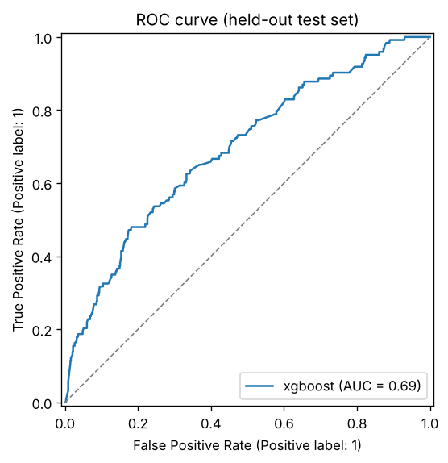
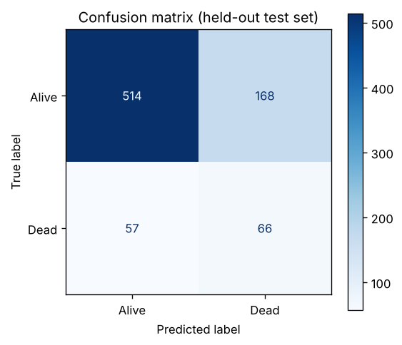

# Cancer Patient Survival Predictor


A reproducible ML pipeline, CLI and REST API that predicts whether a cancer patient will
survive, from four clinical features known at diagnosis.

This project started as a university notebook that reported **93% accuracy**. While turning it
into production-style code I found that the number came from **data leakage**. This repo
documents the bug, measures how much it inflated the results, and replaces the notebook with a
tested, packaged and containerised service.

> ⚠️ Research and portfolio demo only. Not for clinical use.

---

## Highlights

- **Leak-free training.** Imputation, scaling and SMOTE oversampling run inside a single
  `imblearn` pipeline, so each step is fitted on training folds only.
- **Honest evaluation.** A stratified held-out test set is used exactly once. Models are
  compared with 5-fold cross-validation using ROC-AUC, PR-AUC, recall and balanced accuracy,
  which hold up under class imbalance (85% Alive / 15% Dead) where plain accuracy does not.
- **Model selection.** Logistic Regression, Random Forest and XGBoost are each tuned with
  `GridSearchCV`. The best one by CV score is saved together with its metadata.
- **REST API.** FastAPI service with Pydantic validation (including cross-field rules), a
  batch endpoint, health and model-info endpoints, and a 503 response when no model is loaded.
- **Engineering.** `src/` package layout, YAML config, CLI entry point, 31 pytest tests (98%
  coverage), ruff linting, GitHub Actions CI (lint, a test matrix and a Docker smoke test), and
  a multi-stage Docker image that runs as a non-root user.

## The leakage bug, measured

`scripts/leakage_comparison.py` runs the same XGBoost model on the same data with three
methodologies:

| Methodology | Accuracy | ROC-AUC |
|---|---|---|
| Original notebook (SMOTE applied **before** train/test split, uses `survival_months`) | 88.2% | **0.95** |
| Correct split, SMOTE inside pipeline, still uses `survival_months` | 88.6% | 0.82 |
| Correct split, only features known at diagnosis (untuned) | 82.7% | 0.62 |
| Always predict "Alive" (baseline) | **84.7%** | 0.50 |

What went wrong:

1. **Synthetic rows in the test set.** SMOTE creates new minority-class samples by
   interpolating between real ones. The original notebook oversampled first and split
   afterwards, so the test set was full of near-copies of training rows.
2. **Target leakage via `survival_months`.** This is follow-up time *after* diagnosis.
   Patients who died have shorter follow-up by definition, and the value isn't known when a
   prediction would be made. It is now off by default (`include_survival_months` in the config).
3. **Accuracy is misleading here.** Always answering "Alive" already scores 84.7% accuracy.
   Model selection now uses ROC-AUC.

## Results (final pipeline)

Features: `age`, `tumor_size`, `regional_nodes_examined`, `regional_nodes_positive`.

| Model | 5-fold CV ROC-AUC |
|---|---|
| Logistic Regression | 0.695 ± 0.027 |
| Random Forest | 0.689 ± 0.034 |
| **XGBoost (selected)** | **0.698 ± 0.034** |

Held-out test set (805 patients), XGBoost:

| ROC-AUC | PR-AUC | Recall (Dead) | Balanced accuracy |
|---|---|---|---|
| 0.693 | 0.313 (baseline 0.15) | 53.7% | 64.5% |

<p>
  
  
</p>

**Interpretation.** The four features carry real but moderate signal, about 2x the base rate
on PR-AUC. All three model families land within one standard deviation of each other, which
suggests the limit is the information in the data rather than model capacity. The best
hyperparameters are heavily regularised (shallow trees, strong L2 penalty), which fits that
reading. Tuning added about 0.07 ROC-AUC over default XGBoost.

## Project structure

```
├── src/survival_predictor/
│   ├── config.py       # typed, validated YAML config
│   ├── data.py         # loading, schema validation, cleaning
│   ├── pipeline.py     # model registry + leak-free imblearn pipeline
│   ├── train.py        # split -> CV tuning -> model selection -> held-out eval -> artifact
│   ├── evaluate.py     # imbalance-aware metrics + plots
│   ├── predict.py      # artifact loading + validated inference
│   ├── cli.py          # `survival-predictor train | predict`
│   └── api.py          # FastAPI service
├── tests/              # 31 tests: data, pipeline, leakage guard, CLI, API
├── scripts/leakage_comparison.py
├── configs/default.yaml
├── notebooks/01_original_exploration.ipynb   # original notebook, kept for reference
├── reports/            # metrics.json, leakage_comparison.json, figures
├── Dockerfile          # multi-stage: train during build -> slim runtime
└── .github/workflows/ci.yml
```

## Quick start

```bash
git clone https://github.com/lield1096/ML_cancer-patient-survival.git
cd ML_cancer-patient-survival
python -m venv .venv && source .venv/bin/activate
make install        # pip install -e ".[dev]"

make train          # tune + evaluate, writes models/model.joblib and reports/
make test           # pytest with coverage
make compare        # reproduce the leakage table
make serve          # API docs at http://localhost:8000/docs
```

### CLI

```bash
survival-predictor train --config configs/default.yaml
survival-predictor train --include-survival-months    # leaky variant, for comparison
survival-predictor predict patients.csv --threshold 0.4 -o predictions.csv
```

### API

```bash
curl -X POST localhost:8000/predict -H 'Content-Type: application/json' \
  -d '{"age": 55, "tumor_size": 30, "regional_nodes_examined": 14, "regional_nodes_positive": 3}'
# {"probability_dead": 0.4309, "predicted_status": "Alive"}
```

| Endpoint | Description |
|---|---|
| `GET /health` | Liveness and whether a model is loaded |
| `GET /model` | Model name, features, test metrics, training metadata |
| `POST /predict` | Single patient |
| `POST /predict/batch` | Up to 1,000 patients |

Invalid input (negative values, wrong types, more positive nodes than examined) returns `422`
with a descriptive message.

### Docker

```bash
make docker-build   # trains the model inside the build stage
make docker-run     # serves on :8000
```

## Possible next steps

- Treat this as a **survival analysis** problem (Cox model or random survival forests) that
  uses follow-up time correctly as the outcome instead of discarding it.
- Calibrate probabilities and pick the decision threshold from a cost of false negatives.
- Add SHAP explanations to the `/predict` response.

## Dataset

4,024 breast-cancer patients from the public SEER-based breast cancer dataset (diagnosed
2006–2010), with 1 duplicate row removed. Columns: status, age, tumor size (mm), regional nodes examined/positive, survival
months.
